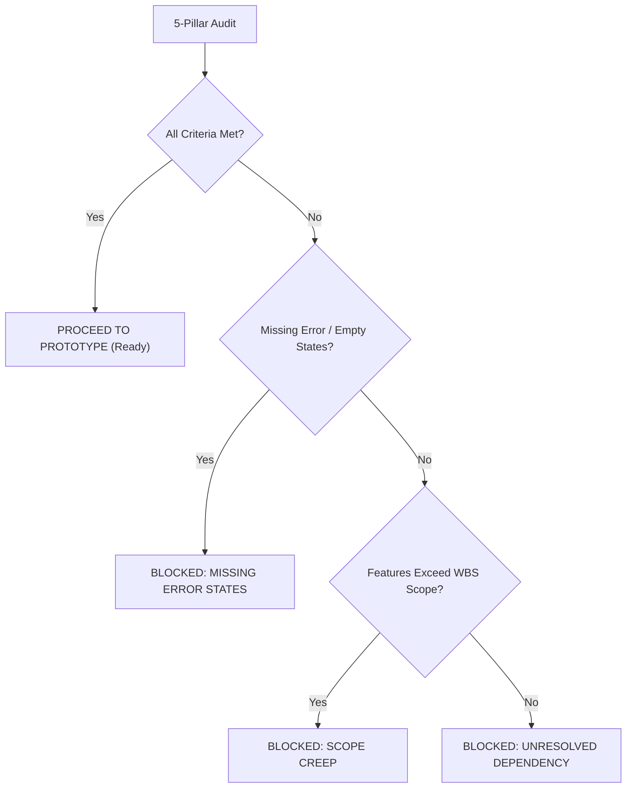

# Stage 1 Pre-Design Readiness & Ambiguity Rubric

> **Platform:** PaDi Design Harness  
> **Target System:** \`padi\` (\`@frontend-shared/padi-ds\`)  
> **Objective:** Eliminate product specification ambiguity *before* writing code or designing UI. Every task must pass this rubric before being promoted to Stage 2 (Interactive Prototype).

---

## 1. Governance Principles

1. **Zero Guesswork:** If an error condition, permission boundary, or fallback state is not documented, the design cannot proceed.
2. **Product WBS Alignment:** The initiative must trace to an active Q4 Product WBS backlog code. If a code is marked \`Drop\` in WBS, work is halted immediately.
3. **Design System First:** The feature must leverage existing \`padi-ds\` components. Any proposed new component or token override must be cataloged in \`src/systems/padi/ds-ledger.json\`.

---

## 2. Five-Pillar Audit Checklist

Before unlocking \`2-locked-brief.md\` and starting prototype development, evaluate each of the five pillars:

### Pillar 1: Source Documentation & Links
- [ ] **PRD or RFC Available:** Documented in Google Docs, SharePoint, or internal Telkom Wiki (\`wiki.digitaltelkom.id\`).
- [ ] **Business Goals Explicit:** Problem statement and quantified success metrics defined (inherited from Product WBS Table 2).
- [ ] **Target Persona Identified:** Clear whether the primary user is Buyer (BUMN / Retail), Seller (UMKM), Financier, or PaDi Admin.

### Pillar 2: User Flow & State Completeness
- [ ] **Happy Path Mapped:** Clear sequence from entry point to successful outcome.
- [ ] **Loading & Skeleton States:** Async operations indicate loader, spinner, or skeleton behaviors.
- [ ] **Zero-Data / Empty States:** What does the user see when no items, transactions, or search results exist?
- [ ] **Error & Failure States:**
  - Network failure / timeout
  - Validation failures (inline error messages)
  - Duplicate submissions or idempotency blocks
  - System or service downtime notifications
- [ ] **Destructive Action Confirmations:** Modals or alerts for cancellation, deletion, or irrevocable approvals.

### Pillar 3: Role & Permission Matrix
- [ ] **Access Control:** Which user roles can view vs. edit this screen?
- [ ] **Disabled vs. Hidden Actions:** Are unauthorized buttons disabled with explanatory tooltips, or hidden entirely?
- [ ] **Multi-Company / Multi-Account Switcher:** Behavior when a user belongs to multiple organizations or branches.

### Pillar 4: Technical & Data Dependencies
- [ ] **API Endpoint Readiness:** Are backend contracts known, or is mock data sufficient for prototyping?
- [ ] **External System Integrations:** Dependencies on Payment Gateway (e.g. PG migration \`PAY#1\`), OSS KBLI verification (\`IDE#2\`), or Taiga tickets.
- [ ] **Pagination & Volume:** Handling large datasets (infinite scroll vs. table pagination).

### Pillar 5: Responsive & A11y Standards
- [ ] **Mobile Breakpoints:** Defined behavior at mobile viewports (< 768px).
- [ ] **Keyboard Navigability:** Tab order, focus rings (\`--padi-focus-ring\`), and Escape hotkeys.
- [ ] **WCAG AA Contrast:** Colors meet 4.5:1 text-to-background contrast ratio using PaDi tokens.

---

## 3. Four Gate Verdicts

Every Stage 1 assessment in \`1-readiness.md\` terminates in one of four explicit verdicts:

### 1. `🟢 PROCEED TO PROTOTYPE`
- **Condition:** All 5 pillars pass. PRD, user stories, happy path, and all 4 UI states (default, loading, empty, error) are clearly specified.
- **Action:** Generates \`2-locked-brief.md\` and unlocks Stage 2 interactive prototyping in \`src/prototypes/wongsdigun/<task-slug>/main.tsx\`.

### 2. `🔴 BLOCKED: MISSING ERROR STATES`
- **Condition:** The PRD or task description specifies the happy path but omits error messaging, failure fallbacks, validation limits, or empty states.
- **Action:** Emits 2–4 targeted blocking questions to the PM / Designer in chat or \`1-readiness.md\`, accompanied by recommended defaults. Prototyping remains blocked until answers are confirmed.

### 3. `🟠 BLOCKED: SCOPE CREEP`
- **Condition:** Proposed feature scope exceeds the Product WBS allocation for the sprint or includes dropped initiatives (e.g. \`EPC#2\` dropped in favor of \`EPC#3\`).
- **Action:** Halts development. Recommends descoping extraneous features to subsequent sprints or filing an RFC with Product Ops.

### 4. `🟡 BLOCKED: UNRESOLVED DEPENDENCY`
- **Condition:** Requires an upstream feature, unreleased API, or unintegrated third-party system that prevents realistic user interaction simulation.
- **Action:** Flags blocking dependency in \`1-readiness.md\`. Recommends mocking the dependency or rescheduling to a downstream sprint.

---

## 4. Steering Protocol

When a task receives a \`BLOCKED\` verdict:
1. The agent documents the exact blockers in \`src/prototypes/<contributor>/<task-slug>/1-readiness.md\`.
2. Each question presents a **(Recommended)** default answer so the PM or Designer can confirm with a single click or brief reply.
3. Once approved, the defaults are written into \`2-locked-brief.md\` as locked assumptions, and the verdict transitions to \`PROCEED TO PROTOTYPE\`.
