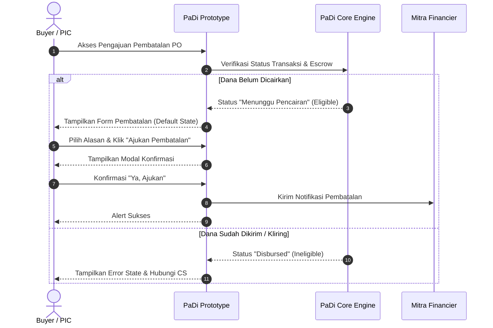

# Stage 2: UX Specification — Flow Pembatalan PO Financing (`FIN#2`)

> **Prototype:** `fin2-flow-pembatalan-po`  
> **System:** `padi` (`@frontend-shared/padi-ds`)  
> **CSS Scope:** `.padi-theme`  
> **Status:** Stage 2 Verified

---

## 1. UI State Matrix

| State | Trigger | Key UI Elements | PaDi DS Components Used |
|---|---|---|---|
| **Default** | PO aktif berstatus "Menunggu Pencairan" | Ringkasan PO, Form Alasan, Modal Konfirmasi | `Card`, `Button`, `Badge`, `Alert` |
| **Loading** | Saat mengecek verifikasi limit ke Core API | Spinner circular bertema PaDi (`#0086cf`), teks penjelasan | `Card` dengan token CSS animasi |
| **Empty** | Tidak ada PO yang dapat dibatalkan | Icon ilustratif, CTA Kembali ke Daftar Transaksi | `Card`, `Button` |
| **Error** | Dana sudah ditransfer / kliring bank | Pesan `Alert` merah tebal, instruksi kontak Helpdesk | `Alert`, `Button`, `Card` |

---

## 2. Component Token Mapping

- **Surfaces:** `var(--padi-color-surface-subtle)` (#f8fafc) & `var(--padi-color-surface-white)`
- **Borders & Radii:** `8px` container, `12px` modal card, `1px solid #cbd5e1`
- **Primary Brand:** `var(--padi-color-brand-primary)` (#0086cf)
- **Interactive Inspector:** Mounts `<PadiInspectorHUD />` toggleable via `Alt + D`

---

## 3. Flow Architecture

