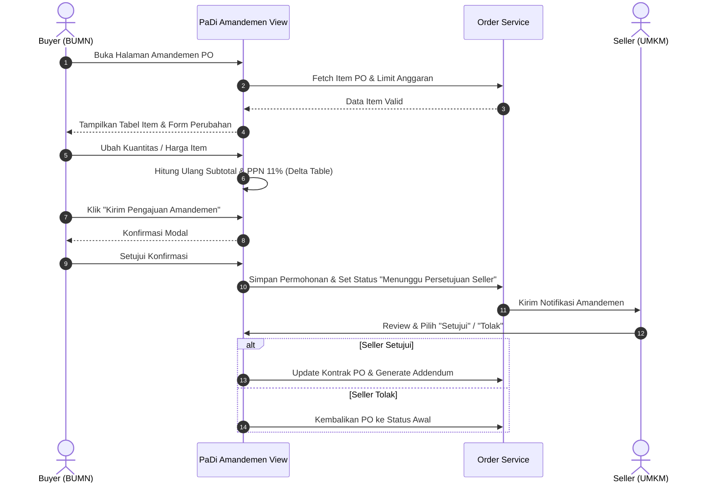

# Stage 2: UX Specification — Amandemen PO (`FUL#1`)

> **Prototype:** `ful1-amandemen-po`  
> **System:** `padi` (`@frontend-shared/padi-ds`)  
> **CSS Scope:** `.padi-theme`  
> **Reference Figma:** `https://www.figma.com/design/ZpKwhiyxCDiaGyBMjNZxub/Amandemen-PO`  

---

## 1. Interaction & State Matrix

| State | Trigger | Key UI Elements | PaDi DS Primitives |
|---|---|---|---|
| **Default** | PO berstatus aktif dapat diamandemen | Tabel item produk dengan stepper kuantitas, ringkasan selisih nilai, tombol "Kirim Pengajuan" | `Card`, `Table`, `Badge`, `Button`, `Input` |
| **Loading** | Saat melakukan kalkulasi ulang pajak atau submit | Skeleton placeholder pada baris tabel & card ringkasan | `Skeleton`, CSS animasi bertema PaDi |
| **Empty** | PO yang sudah selesai / tidak ada hak amandemen | Info card dengan pesan tidak ada item yang dapat diamandemen | `Card`, `Badge`, `Button` |
| **Error** | Nominal melebihi pagu anggaran Buyer | Inline `Alert` error dengan rincian over-budget dan tombol reset | `Alert`, `Button` |

---

## 2. Token & Styling Alignment

- **Design Tokens Applied:**
  - `var(--padi-color-surface-white)` (#ffffff)
  - `var(--padi-color-surface-subtle)` (#f8fafc)
  - `var(--padi-color-brand-primary)` (#0086cf)
  - `var(--padi-color-text-primary)` (#0f172a)
  - `var(--padi-color-text-secondary)` (#64748b)
  - `var(--padi-radius-md)` (8px)
  - `var(--padi-shadow-sm)` & `var(--padi-shadow-md)`
- **Portals:** Modal konfirmasi dialog dirender menggunakan container portal `.padi-theme`.
- **Instrumentation:** `<PadiInspectorHUD />` dipasang di root template untuk verifikasi token `Alt + D`.

---

## 3. Visual Workflow Topology

